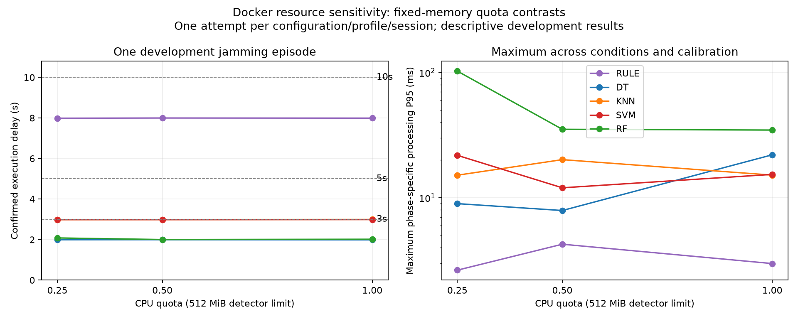
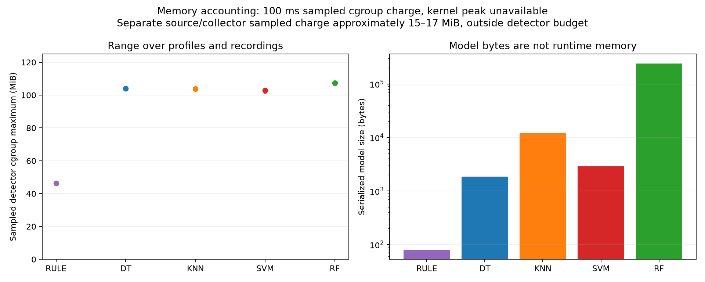
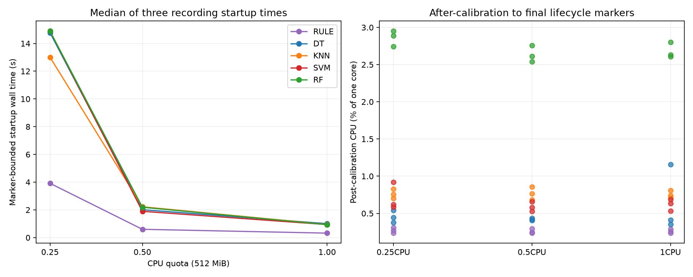
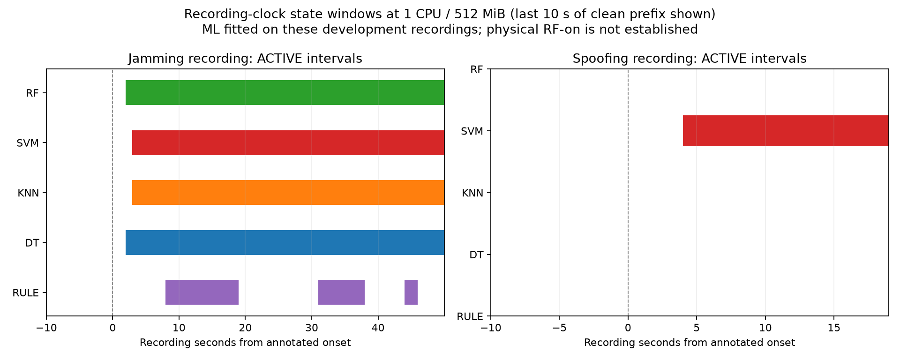

# Completed Docker pilot analysis

The repeated 60-attempt pilot completed on 27 October 2026. This directory contains analysis of retained original-rate traces, not a new experiment or independent validation.

- [Report and limitations](REPORT.md)
- [Machine-readable summary](summary.json)
- [Platform details](platform.json) and [analysis verification](verification.json)
- [Exact selected configurations, policies and trial order](experiment_manifest.json)
- [Source hashes and frozen image identities](provenance.json)
- [Article results draft](ARTICLE_RESULTS_DRAFT.md)

## Tables

| File | Meaning |
|---|---|
| `tables/trials.csv` | 60 individual attempts; per-recording latency, CPU, startup, memory and queue metrics |
| `tables/config_profiles.csv` | 20 configuration/profile combinations; explicit maxima and recording exposure |
| `tables/conditions.csv` | Benign and spoofing false events, exposure, observed active durations and censoring |
| `tables/events.csv` | Individual event boundaries; repeated events within one recording are not new episodes |
| `tables/triggering_messages.csv` | 20 jamming trigger observations; sample delay versus software delivery/queue/processing |
| `tables/latency_conditions.csv` | Calibration and condition-specific empirical processing quantiles and sample counts |
| `tables/functional_scenarios.csv` | 540 sensitivity-grid ledger rows, not independent experiments |
| `tables/pareto_descriptive.csv` | Descriptive within-profile front membership after empirical functional screening |
| `tables/trace_integrity.csv` | Exact sequence, clock identity, actual limit, raw latency quantile and queue-integral checks |

## Figures









## Reconstruction

To rebuild the compact report from the shipped tables without raw data:

```sh
python3 scripts/reconstruct_pilot_report.py --archive results/docker_pilot_repeat_20261027 --output build/NEW_RECONSTRUCTION
# Add --figures in the pinned scientific environment.
```

This renders archived evidence; it does not repeat raw-trace verification.

For full re-analysis with the retained run bundle and trusted frozen input workspace available:

```sh
python3 scripts/analyze_docker_pilot.py --run-root /path/to/completed-run --output build/NEW_ANALYSIS
# Add --figures in the pinned scientific environment.
```

The script validates frozen input hashes and original trace contents, reconstructs continuous-time waiting counts, recalculates latency quantiles, and keeps all trial artifacts unchanged. The compact GitHub snapshot does not include the complete trace/model bundle. README and article interpretation are editorial companions; the script regenerates numerical tables, REPORT.md, summary/provenance and requested figures.

Memory is sampled cgroup charge, not guaranteed peak or intrinsic model footprint. Post-calibration CPU and startup-inclusive external CPU are separate scopes. The source/collector has its own allocation outside the detector budget. Native macOS latency/model-size budgets are not transferred to Docker. All inferential evidence remains INSUFFICIENT EVIDENCE.
